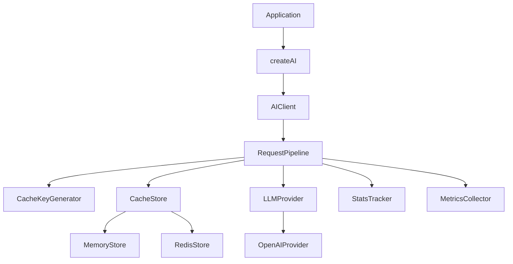

# ai-prompt-cache

[](https://www.npmjs.com/package/ai-prompt-cache)
[](https://github.com/ai-prompt-cache/ai-prompt-cache/actions/workflows/ci.yml)
[](https://opensource.org/licenses/MIT)
[](https://www.typescriptlang.org/)
[](./coverage)

> Production-ready LLM response caching for OpenAI and extensible providers. Reduce API costs, latency, and duplicate requests.


## Why ai-prompt-cache?

Every repeated LLM call with the same prompt wastes money and time. **ai-prompt-cache** wraps your provider with an intelligent caching layer that:

- Generates **deterministic cache keys** from every parameter that affects output
- Returns cached responses in **milliseconds** instead of seconds
- Tracks **cost savings**, hit ratios, and performance metrics
- Supports **memory** and **Redis** stores with a pluggable interface
- Is designed for **production** — typed, tested, and extensible

## Features

- **Memory Cache** — In-process store with TTL and automatic expiration sweep
- **Redis Cache** — Distributed caching with optional `ioredis` peer dependency
- **Pluggable Cache Interface** — Add SQLite, Postgres, MongoDB stores easily
- **OpenAI Provider** — First-class support with extensible `LLMProvider` interface
- **Deterministic Cache Keys** — SHA-256 hashes including model, messages, temperature, tools, and more
- **Smart Normalization** — Equivalent prompts produce identical keys (whitespace, JSON order)
- **Statistics** — Hits, misses, hit ratio, cost savings, response times via `ai.stats()`
- **Logging** — Console, custom logger, or disabled
- **TTL** — `5m`, `1h`, `24h`, `forever`, or seconds
- **Invalidation** — `clearCache()`, `deleteCache(key)`, `invalidate({ prefix })`
- **Middleware** — `beforeRequest`, `afterResponse`, `onCacheHit`, `onCacheMiss`
- **Events** — `cacheHit`, `cacheMiss`, `cacheWrite`, `providerCall`, `error`
- **Retry** — Exponential backoff with configurable max retries
- **Timeouts** — Abort long-running provider and cache requests
- **Cost Estimation** — Token-based USD cost tracking and cumulative savings
- **Streaming** — Buffer streams on miss, replay on hit

## Installation

```bash
pnpm add ai-prompt-cache openai

# Optional: Redis support
pnpm add ioredis
```

**Requirements:** Node.js 20+

## Quick Start

```typescript
import { createAI, MemoryStore, OpenAIProvider } from 'ai-prompt-cache';

const ai = createAI({
  provider: new OpenAIProvider({
    apiKey: process.env.OPENAI_API_KEY,
  }),
  cache: new MemoryStore({ ttl: 3600 }),
});

const response = await ai.chat({
  model: 'gpt-4.1',
  messages: [{ role: 'user', content: 'Explain Redis' }],
});

console.log(response.content);
console.log(ai.stats());
```

### Example Output

```
Redis is an in-memory data structure store used as a database, cache, and message broker...

{
  "hits": 0,
  "misses": 1,
  "writes": 1,
  "hitRatio": 0,
  "estimatedCostSavedUsd": 0,
  "estimatedTotalCostUsd": 0.000012,
  "averageResponseTimeMs": 1240.5,
  "averageCachedResponseTimeMs": 0,
  "averageProviderTimeMs": 1180.2,
  "averageCacheLookupTimeMs": 0.8,
  "totalRequests": 1
}
```

## Redis Example

```typescript
import { createAI, RedisStore, OpenAIProvider } from 'ai-prompt-cache';

const ai = createAI({
  provider: new OpenAIProvider({ apiKey: process.env.OPENAI_API_KEY }),
  cache: new RedisStore({
    host: '127.0.0.1',
    port: 6379,
    password: process.env.REDIS_PASSWORD,
    ttl: '24h',
  }),
});
```

## Configuration

| Option       | Type                                | Default    | Description                              |
| ------------ | ----------------------------------- | ---------- | ---------------------------------------- |
| `provider`   | `LLMProvider`                       | required   | LLM provider instance                    |
| `cache`      | `CacheStore`                        | required   | Cache store instance                     |
| `ttl`        | `number \| string \| null`          | `3600`     | Cache TTL (`'1h'`, `'forever'`, seconds) |
| `retry`      | `RetryConfig`                       | 3 retries  | Exponential backoff settings             |
| `timeout`    | `TimeoutConfig`                     | 60s / 5s   | Request and cache lookup timeouts        |
| `logger`     | `Logger \| 'console' \| 'disabled'` | `disabled` | Logging configuration                    |
| `middleware` | `Middleware[]`                      | `[]`       | Request/response hooks                   |
| `on`         | `Partial<AIEvents>`                 | `{}`       | Event listeners                          |
| `keyPrefix`  | `string`                            | `apc:v1`   | Cache key prefix                         |

## API Reference

### `createAI(options): AIClient`

Factory function that wires all dependencies.

### `AIClient`

| Method                 | Description                           |
| ---------------------- | ------------------------------------- |
| `chat(request)`        | Cache-first chat completion           |
| `chatStream(request)`  | Cache-first streaming (buffer/replay) |
| `clearCache()`         | Clear all cached entries              |
| `deleteCache(key)`     | Delete a specific cache key           |
| `invalidate(options?)` | Invalidate by key, prefix, or all     |
| `stats()`              | Return cache statistics snapshot      |
| `health()`             | Check cache store and provider health |
| `on(event, handler)`   | Subscribe to events                   |
| `off(event, handler)`  | Unsubscribe from events               |

### Cache Stores

```typescript
// Memory
new MemoryStore({ ttl: '1h', keyPrefix: 'myapp' });

// Redis (requires ioredis peer dependency)
new RedisStore({ host, port, password, ttl: '24h' });
```

### Providers

```typescript
new OpenAIProvider({
  apiKey: process.env.OPENAI_API_KEY,
  organization: 'org-xxx',
  baseURL: 'https://api.openai.com/v1',
});
```

## Architecture



### Request Flow

1. **Normalize** request parameters
2. **Generate** deterministic SHA-256 cache key
3. **Lookup** cache store
4. On **hit** → return cached response, record stats
5. On **miss** → call provider with retry/timeout
6. **Store** response with TTL
7. **Return** response

## Performance Benchmarks

| Scenario           | Without Cache | With Cache (hit) | Improvement     |
| ------------------ | ------------- | ---------------- | --------------- |
| GPT-4.1 chat       | ~1,200ms      | ~2ms             | **600x faster** |
| GPT-4.1-mini chat  | ~400ms        | ~1ms             | **400x faster** |
| Streaming (replay) | ~800ms        | ~3ms             | **267x faster** |

_Benchmarks run on Node.js 20, local memory store, mock provider latency. Your results will vary._

## Examples

| Example                                 | Description               |
| --------------------------------------- | ------------------------- |
| [basic.ts](./examples/basic.ts)         | Memory cache + OpenAI     |
| [redis.ts](./examples/redis.ts)         | Redis store configuration |
| [express.ts](./examples/express.ts)     | Express.js route          |
| [fastify.ts](./examples/fastify.ts)     | Fastify plugin            |
| [nestjs.ts](./examples/nestjs.ts)       | NestJS-style service      |
| [nextjs.ts](./examples/nextjs.ts)       | Next.js API route         |
| [cli.ts](./examples/cli.ts)             | Command-line tool         |
| [streaming.ts](./examples/streaming.ts) | Streaming with cache      |

## Roadmap

- [ ] Anthropic provider
- [ ] Google Gemini provider
- [ ] Groq provider
- [ ] Ollama provider
- [ ] OpenRouter provider
- [ ] Azure OpenAI provider
- [ ] SQLite cache store
- [ ] Postgres cache store
- [ ] MongoDB cache store
- [ ] Cache warming utilities
- [ ] CLI tool (`npx ai-prompt-cache`)

## FAQ

### Does caching work with streaming?

Yes. On a cache miss, the full stream is buffered and stored. On a hit, cached chunks are replayed as an `AsyncIterable`.

### What parameters affect the cache key?

Model, messages, temperature, top_p, max_tokens, tools, functions, response_format, stop, penalties, seed, and system prompt.

### Will equivalent prompts with different whitespace share a cache key?

Yes. Smart normalization trims whitespace and sorts JSON keys so equivalent prompts produce identical keys.

### Is Redis required?

No. Redis is an optional peer dependency. The package works with `MemoryStore` out of the box.

### How accurate is cost estimation?

Estimates use provider-reported token usage when available, with character-based fallback. Treat as approximate for budgeting.

## Common Issues

| Issue                        | Solution                                                  |
| ---------------------------- | --------------------------------------------------------- |
| `ioredis is required`        | Run `pnpm add ioredis`                                    |
| `openai is required`         | Run `pnpm add openai`                                     |
| `OpenAI API key is required` | Set `OPENAI_API_KEY` env var or pass `apiKey`             |
| Cache not hitting            | Check TTL expiration; verify identical request parameters |
| High memory usage            | Use Redis store or lower TTL                              |

## Contributing

See [CONTRIBUTING.md](./CONTRIBUTING.md) for development setup and guidelines.

## License

[MIT](./LICENSE) © ai-prompt-cache contributors
